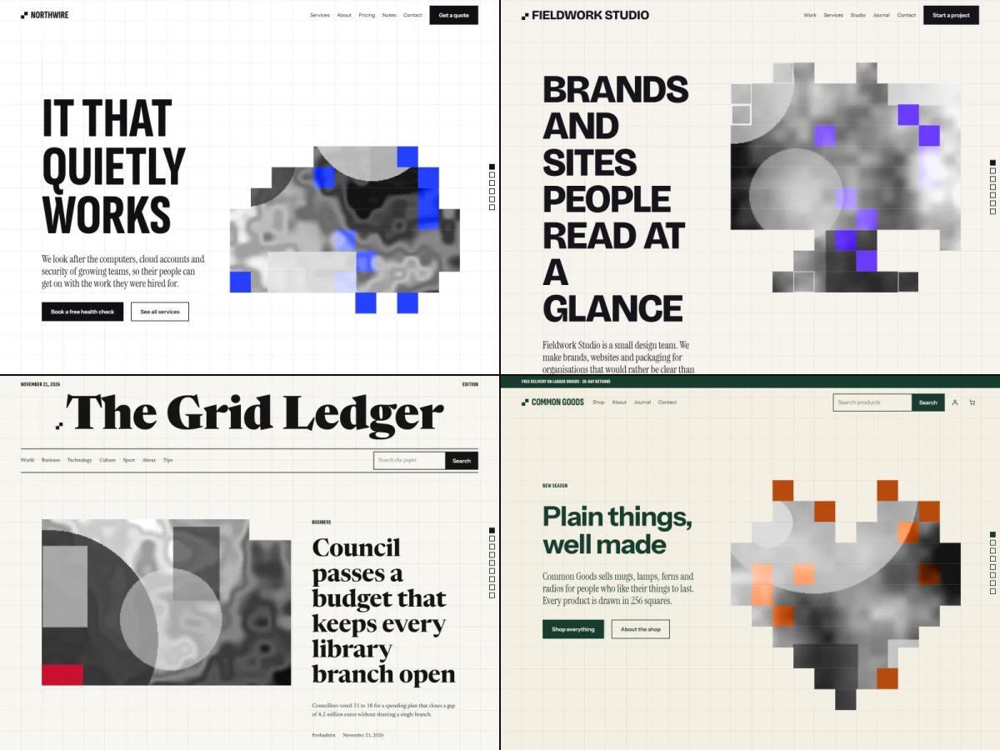

# Pixelgrid

A WordPress block theme for IT companies, design studios, news sites and shops. Every page sits on one pixel grid: bold condensed headlines, full-page colour sections that change as you scroll, and photos shown through pixel icons. Four starting points are included: IT services, Agency, News and Shop (the Shop needs WooCommerce). WooCommerce pages are styled on the same grid with any starting point.



## Requirements

- WordPress 6.6 or later (tested up to 7.1)
- PHP 7.4 or later
- Optional: WooCommerce, for the Shop starting point and shop pages. The theme does not install it.

## Install

Copy this folder into `wp-content/themes/pixelgrid`, then activate **Pixelgrid** under Appearance, Themes.

## Starter content

On a new site the Dashboard shows a one-time notice. Click **Set up starter content**, or go to **Appearance, Pixelgrid setup** at any time, choose a starting point, tick what you want (pages, sample posts, menu, homepage setting, and optionally the starting point's design: styles, header, footer, templates) and click **Add starter content**. Each starting point is shown with a preview:

- **IT services**: Home, Services, About, Pricing, Contact and Notes pages, and six sample notes (posts). Its design is the theme default.
- **Agency**: Home, Work with six case studies, Services, Studio, Contact and Journal pages, and six sample journal posts. Its design changes the colours, fonts (Bricolage Grotesque display face), header, footer and blog template.
- **News**: Home, Latest, About, Contact and Tips pages, and 15 sample articles in World, Business, Technology, Culture and Sport (an article can be in several categories). The menu links the five sections, About and Tips, and the Home rows are filled with the new categories. Its design changes the colours and fonts (the Newsreader serif), header (a masthead with today's date), footer, and the templates for the posts page, single articles (with a related-articles row) and category pages (section fronts). "Most read" is a category you fill yourself, because the theme does not count views; it is hidden from the category labels on articles.
- **Shop** (needs WooCommerce): Home, About, Contact and Journal pages, plus WooCommerce's own shop, cart, checkout and account pages, linked as Shop in the menu (only while the shop page is published). 12 sample products in Kitchen, Home, Outdoor and Tech with pixel-art pictures (four on sale, four featured), and three journal posts. Its design changes the colours, header (product search, account and mini-cart), footer and posts page template. Without WooCommerce the Shop is shown but cannot be chosen, with a link to the plugin installer. Prices are plain numbers: currency, payments and shipping are WooCommerce settings.

Nothing is added until you click, nothing is downloaded, and running it twice makes no duplicates. Applying a design backs up your current styles, header, footer and templates first. The IT services design is the theme default, so applying it does not change your Styles. Applying a design again only changes what you have not edited since setup. The same screen shows the starting point in use and can remove everything it added, restoring the backups and keeping edits you made after setup. Removal also trashes the starter products and deletes the categories, product categories and tags setup created once no other post, including drafts, uses them.

The setup follows the WordPress.org theme rules: core admin UI only, user consent before any content is created, no external calls, and a dismissible notice limited to the Dashboard and Themes screens.

## Build a page like the demo by hand

1. Create a page and pick the **Sections, no title** template.
2. In the block inserter, open Patterns, then **Pixelgrid pages**, and insert a layout (Home, About, Services, Pricing, Contact). Or build your own from **Pixelgrid sections**.
3. To use it as the home page: Settings, Reading, static front page.

## What is in the theme

| Area | Details |
|---|---|
| Section colours | Group block styles: Light, Bold, Bright, Dark, Soft, Alert. The page fades to the colour of the section in view. |
| Editable colours | Every section and the footer have four palette colours (background, text, hover, text on hover), changed in Appearance, Editor, Styles, Colours, Palette. Hover covers the cursor squares, button and link hover, and highlighted pixels. |
| Pixel mosaics | Image block styles that draw the photo through an 11 by 11 pixel icon: screen, cloud, padlock, speech bubble, chart, people, envelope, note, 404, heart, or one that changes. Visitors can click pixels to redraw. |
| Other block styles | Lead and Big number paragraphs, Pixel bullets and Wordmarks lists, Pixel notch images, Price plan groups, Chips for categories and tags. |
| Templates | Blog, single post with sidebar, page, archive, search, 404, and Sections, no title. The News design adds its own posts page, article and category templates. |
| WooCommerce | Grid-styled templates for the shop, product categories and tags, single product, product search, cart, checkout and order confirmation, plus a mini-cart part. Used with every starting point while WooCommerce is active. |
| Patterns | Sections and full pages in **Pixelgrid sections** and **Pixelgrid pages**, plus the Agency set in **Pixelgrid Agency**, the News set in **Pixelgrid News** and the Shop set in **Pixelgrid Shop** (shown while WooCommerce is active). All text is translatable. |
| Fonts | Instrument Sans, Instrument Serif, Sofia Sans Extra Condensed, Bricolage Grotesque and Newsreader, bundled locally (SIL Open Font License). |

The colour change, mosaics, background grid and section index need JavaScript. Without it, sections keep their own colour and pictures show as black and white images. The theme respects the visitor's reduced motion setting. The News masthead date comes from a "Today's date" block binding (`pixelgrid/today`).

## Files

```
theme.json          colours, fonts, sizes, spacing, block styles
styles/             style variations used by the Agency, News and Shop designs
style.css           theme header, grid unit, tones, mosaic and layout rules
functions.php       asset loading, block styles, pattern categories
inc/                starter content setup page, the starting points (inc/variants/) and front-end helpers (today's date, related articles)
assets/js/          pixelgrid.js (grid, mosaics, tones, section index)
assets/fonts/       bundled woff2 files
assets/images/      original abstract images and pixel-art product pictures, setup previews
templates/  parts/  patterns/   (including the WooCommerce templates and mini-cart part)
```

## Release zip

The zip for WordPress.org contains the `pixelgrid` folder without `.git` and this README.

## License

GPLv2 or later. Font and image credits are in `readme.txt`.
